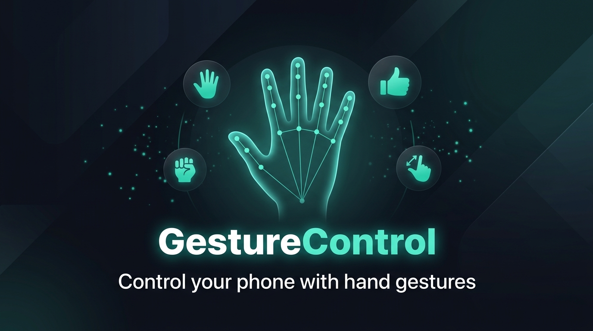
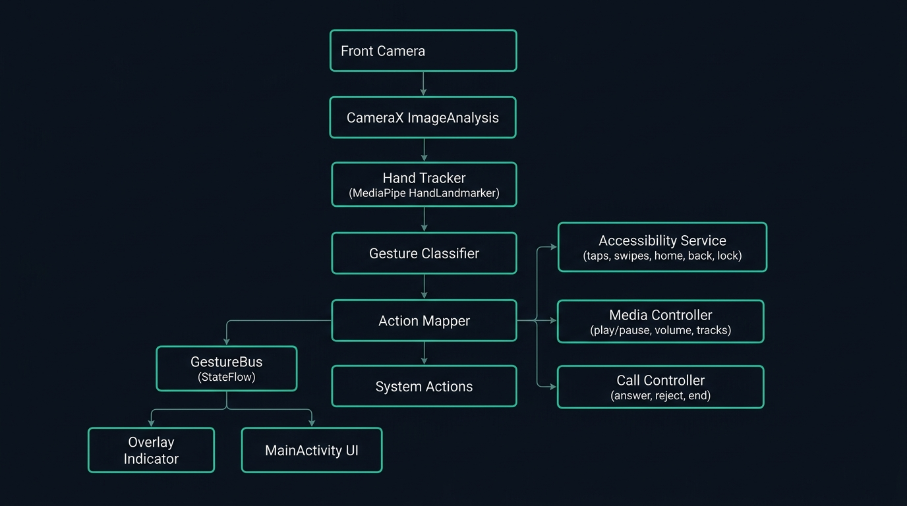

<p align="center">
  
</p>

<p align="center">
  <strong>Control your Android phone entirely with hand gestures — no screen touch required.</strong>
</p>

<p align="center">
  
  
  
  
  
</p>

---

## ✨ What is GestureControl?

**GestureControl** is a real-time hand gesture recognition app that transforms your front camera into a touchless controller. Built on **Google MediaPipe's Hand Landmarker** and **Android Accessibility Services**, it detects 8 distinct hand gestures and maps them to system actions — navigation, media playback, and call management — all without touching the screen.

Perfect for:
- 🍳 **Cooking** — scroll recipes hands-free
- 🏋️ **Working out** — skip tracks, adjust volume  
- 🚗 **Driving** — answer/reject calls with a gesture
- ♿ **Accessibility** — touchless phone interaction

---

## 🎯 Features

### 🖐️ 8 Recognized Gestures
| Gesture | Icon | Detection |
|---------|------|-----------|
| Open Palm | 🖐️ | 4+ fingers extended |
| Fist | ✊ | 0 fingers extended |
| Thumbs Up | 👍 | Thumb extended, fingers curled |
| Pinch | 🤏 | Thumb-index distance < threshold |
| One Finger | ☝️ | Index pointing up, others curled |
| Two Fingers | ✌️ | Index + middle up, others curled |
| Three Fingers | 🤟 | Index + middle + ring extended |
| No Hand | — | No hand detected |

### 📱 Three Operating Modes

<details>
<summary><strong>🧭 Normal Mode</strong> — Navigation & System Actions</summary>

| Gesture | Hold Time | Action |
|---------|-----------|--------|
| 🖐️ Open Palm | 1s | **Home** |
| ✊ Fist | 1s | **Back** |
| ✊ Fist | 3s | **Lock Screen** |
| 👍 Thumbs Up | 0.4s | **Tap** (center screen) |
| ☝️ One Finger | 0.6s | **Swipe Up** |
| ✌️ Two Fingers | 0.6s | **Swipe Down** |
| 🤟 Three Fingers | 1s | **Open WhatsApp** |
| 🤟 Three Fingers | 2.5s | **Toggle Armed/Paused** |
| 🤏 Pinch | 1.5s | **Toggle Media Mode** |

</details>

<details>
<summary><strong>🎵 Media Mode</strong> — Full Media Playback Control</summary>

| Gesture | Hold Time | Action |
|---------|-----------|--------|
| 👍 Thumbs Up | 0.4s | **Play / Pause** |
| ☝️ One Finger | Hold | **Volume Up** (auto-repeat) |
| ✌️ Two Fingers | Hold | **Volume Down** (auto-repeat) |
| ✊ Fist | 1s | **Previous Track** |
| 🤟 Three Fingers | 1s | **Next Track** |

</details>

<details>
<summary><strong>📞 Call Mode</strong> — Automatic During Incoming/Active Calls</summary>

| Gesture | Hold Time | Action |
|---------|-----------|--------|
| 👍 Thumbs Up | 0.7s | **Answer Call** |
| 🖐️ Open Palm | 1s | **Reject Call** |
| ✊ Fist | 2s | **End Call** |

</details>

### 🎨 Smart Overlay Indicator

A floating status pill overlay sits above all apps:

| Dot Color | Meaning |
|-----------|---------|
| 🔘 Grey | No hand detected / camera scanning |
| 🟡 Amber | Hand detected but **paused** |
| 🟢 Teal | **Armed** and ready |
| 🟣 Violet | **Media Mode** active |
| 🔴 Red | Tracker error (visible in release builds) |
| 🟡↔🟢 Pulsing | Incoming call |

The pill shows the current gesture name, a hold-progress ring, action confirmations, and automatically collapses to a minimal dot after 3 seconds of no hand activity.

### ⚡ Quick Settings Tile

Toggle gesture control directly from the notification shade with the built-in Quick Settings Tile — shows live status (Off / Paused / Armed / Media Mode).

---

## 🏗️ Architecture

<p align="center">
  
</p>

```
Front Camera
    │
    ▼
CameraX ImageAnalysis (RGBA → Bitmap → rotate + mirror)
    │
    ▼
HandTracker (MediaPipe HandLandmarker, LIVE_STREAM mode)
    │
    ▼
GestureClassifier (21 landmarks → finger ratios → 8 gestures + stability filter)
    │
    ▼
GestureBus (Kotlin StateFlow hub — reactive, thread-safe)
    │
    ├──▶ ActionMapper (hold timers, tiered actions, flicker rejection)
    │       ├── AccessibilityService (taps, swipes, home, back, lock)
    │       ├── MediaController (volume, play/pause, tracks)
    │       └── CallController (answer, reject, end)
    │
    ├──▶ OverlayIndicator (floating pill with status dot + gesture label)
    │
    └──▶ MainActivity / Compose UI (home, gesture guide, settings)
```

### Key Design Decisions

- **Tiered Hold Actions**: Fist and Three-Fingers use a multi-tier hold system — short hold fires one action (Back), longer hold fires another (Lock Screen). Action fires on *release* at the reached tier, preventing accidental triggers.
- **Flicker Rejection**: A 150–300ms debounce window prevents rapid gesture transitions from firing spurious actions.
- **Stability Filter**: Gestures must appear in 4 out of 5 consecutive frames before being accepted, eliminating false positives.
- **Wrist Movement Guard**: Palm → Home only fires if the wrist hasn't moved significantly during the hold, distinguishing intentional holds from casual hand movement.

---

## 🛠️ Tech Stack

| Component | Technology |
|-----------|-----------|
| **Hand Tracking** | [MediaPipe Tasks Vision](https://developers.google.com/mediapipe/solutions/vision/hand_landmarker) (0.10.14) |
| **Camera** | CameraX (camera2 backend, 1.3.4) |
| **UI** | Jetpack Compose + Material 3 |
| **System Actions** | Android Accessibility Service |
| **State Management** | Kotlin `StateFlow` / `SharedFlow` |
| **Background Service** | `LifecycleService` with foreground camera notification |
| **Quick Settings** | `TileService` |
| **Min SDK** | Android 7.0 (API 24) |
| **Target SDK** | Android 16 (API 36) |

---

## 📦 Installation

### Prerequisites
- Android Studio Ladybug or newer
- JDK 21
- Android SDK 37

### Build from Source

```bash
# Clone the repository
git clone https://github.com/YOUR_USERNAME/GestureControl.git
cd GestureControl

# Build the release APK (signed with debug keystore for easy sideloading)
./gradlew assembleRelease

# The APK is at:
# app/build/outputs/apk/release/app-release.apk
```

### Install on Device

```bash
# Via ADB
adb install -r app/build/outputs/apk/release/app-release.apk

# Or transfer the APK file to your phone and install manually
```

### First Launch Setup

1. **Grant Camera Permission** — needed to see your hand
2. **Enable Accessibility Service** — needed to perform taps, swipes, and system actions
3. **Optional: Grant Call Permission** — for hands-free call management
4. **Tap the power button** on the home screen to start

---

## 🎮 Usage Guide

### Getting Started
1. Launch the app → complete the onboarding
2. Grant Camera and Accessibility permissions
3. Tap the **Power Button** on the home screen
4. Hold up **three fingers for 2.5 seconds** to arm the gesture system

### Pro Tips
- 🌟 **Good lighting** dramatically improves detection accuracy
- 📏 Keep your hand **30–60 cm** from the front camera
- ✊ Keep unused fingers **fully curled** for cleaner gesture recognition
- 🤏 **Pinch** to enter Media Mode when listening to music
- 🔒 **Fist for 3 seconds** to lock the screen instantly
- ⏸️ **Three fingers for 2.5s** to pause/resume gesture recognition

### Quick Settings Tile
Pull down the notification shade → Edit tiles → Add **"Gesture Control"** for one-tap toggle.

---

## 📁 Project Structure

```
app/src/main/
├── assets/
│   └── hand_landmarker.task          # MediaPipe hand tracking model (~7.5 MB)
├── java/com/example/gesturecontrol/
│   ├── MainActivity.kt               # Entry point, permissions
│   ├── MainApp.kt                     # Compose navigation scaffold
│   ├── HandTracker.kt                 # MediaPipe HandLandmarker wrapper
│   ├── GestureClassifier.kt           # Landmark → Gesture classification
│   ├── Gesture.kt                     # Gesture enum, GestureBus state hub
│   ├── GestureService.kt              # Foreground camera service
│   ├── GestureAccessibilityService.kt # Accessibility + overlay host
│   ├── ActionMapper.kt                # Gesture → Action mapping engine
│   ├── MediaController.kt             # Media playback controls
│   ├── CallController.kt              # Telephony call controls
│   ├── CallStateMonitor.kt            # Phone state listener
│   ├── OverlayIndicator.kt            # Floating status pill overlay
│   ├── GestureTileService.kt          # Quick Settings tile
│   └── ui/
│       ├── screens/                   # Home, Gestures, Settings, Onboarding
│       ├── components/                # Reusable UI components
│       └── theme/                     # Dark theme, colors, typography
└── res/
    ├── drawable/                       # Adaptive icon, tile icon
    └── xml/                           # Accessibility service config
```

---

## 🔧 Release Build Notes

The release build is specifically configured to keep MediaPipe working correctly:

```kotlin
// Assets must NOT be compressed (MediaPipe needs raw file descriptor access)
androidResources {
    noCompress += listOf("task", "tflite")
}

// Minification disabled to protect MediaPipe JNI, protobuf reflection
release {
    isMinifyEnabled = false
    isShrinkResources = false
    signingConfig = signingConfigs.getByName("debug")  // Easy sideloading
}
```

ProGuard rules (`proguard-rules.pro`) keep MediaPipe, Protobuf, and all app service classes safe from stripping.

---

## 🤝 Contributing

Contributions are welcome! Here are some ideas:

- [ ] Custom gesture-to-action mapping UI
- [ ] Gesture recording and training
- [ ] Multi-hand support
- [ ] Landscape orientation support
- [ ] Wear OS companion for remote trigger
- [ ] Customizable hold durations per gesture

---

## 📄 License

This project is licensed under the MIT License — see the [LICENSE](LICENSE) file for details.

---

<p align="center">
  <strong>Built with ❤️ using MediaPipe, Kotlin & Jetpack Compose</strong>
</p>
